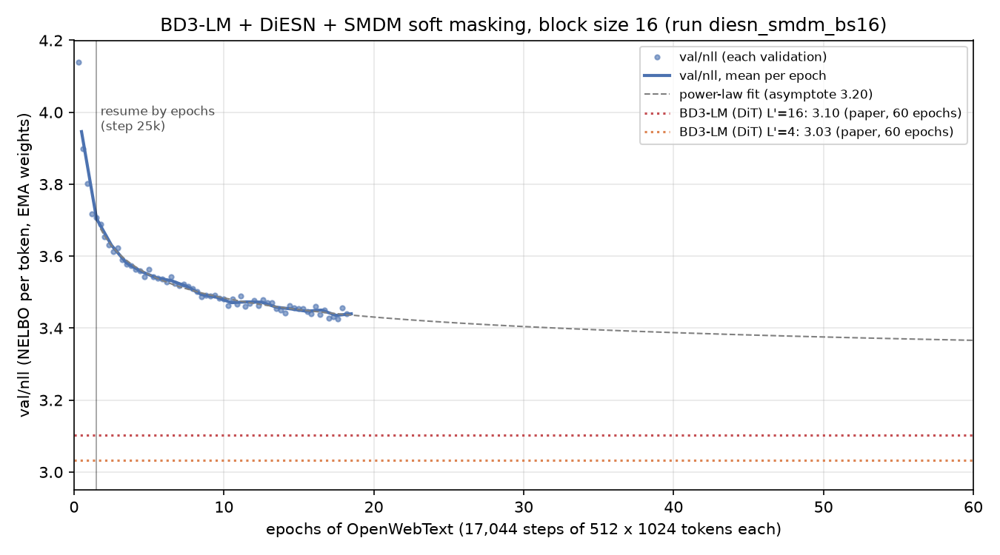
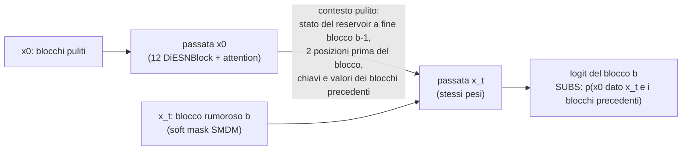
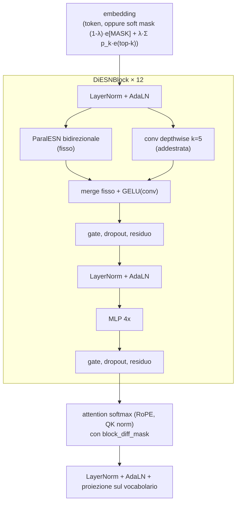

# Block Diffusion con DiESN: un BD3-LM senza Transformer

Tesi magistrale (Università di Pisa). Il punto di partenza è **BD3-LM** ([Block Diffusion, Arriola et al., ICLR 2025](https://arxiv.org/abs/2503.09573)), un modello del linguaggio a diffusione discreta per blocchi. Qui il denoiser **non è il Transformer (DiT) del paper** ma **DiESN**:

- 12 blocchi con un reservoir **ParalESN** bidirezionale (fisso, non addestrato) e una convoluzione locale;
- un solo strato di **attention softmax**;
- il **soft masking di SMDM** (IBM) sui token mascherati.

L'obiettivo è capire quanto di un BD3-LM regge quando quasi tutto il mescolamento lungo la sequenza è affidato a reservoir lineari a pesi casuali, invece che a 12 strati di self-attention addestrati.



## Block diffusion in breve

BD3-LM divide la sequenza (1024 token) in **blocchi di 16 token**:

- **tra blocchi** la generazione è **autoregressiva**: il blocco b dipende solo dai blocchi < b;
- **dentro un blocco** il denoising è **diffusione discreta a mascheramento** (MDLM): si parte da un blocco di soli `[MASK]` e lo si smaschera in modo bidirezionale.

In training BD3-LM fa un solo forward sulla concatenazione `[x_t, x0]`, dove x_t sono i blocchi rumorosi e x0 quelli puliti, con la maschera `block_diff_mask`:

| Parte della maschera | Chi legge cosa |
|---|---|
| **M_BD** (block diagonal) | ogni blocco legge tutto il proprio blocco, in entrambe le direzioni |
| **M_OBC** (offset block causal) | il blocco rumoroso b legge i blocchi puliti < b, cioè il contesto |
| **M_BC** (block causal) | il blocco pulito b legge i blocchi puliti ≤ b |

In un Transformer la maschera sta tutta nell'attention. **DiESN invece sposta l'informazione lungo la sequenza in tre moduli diversi**, e ognuno deve rispettare la stessa maschera: è il cuore del lavoro (`lightning/diesn_bd3.py`).

| Modulo di DiESN | Dentro il blocco (M_BD) | Tra blocchi (M_OBC, M_BC) |
|---|---|---|
| **ParalESN bidirezionale** (reservoir lineari a coefficienti complessi, fissi) | entrambi i reservoir leggono tutto il blocco | il reservoir *forward* scorre lungo tutta la sequenza pulita e porta il contesto. Quello *backward* riparte a ogni blocco, altrimenti leggerebbe il futuro. Il blocco rumoroso b riparte dallo stato pulito di fine blocco b-1 con una correzione esatta per linearità: `h_t = h_t^blocco + λ^(k+1) · h^x0_(s_b - 1)` |
| **Convoluzione depthwise** (k = 5) | legge ±2 posizioni | le 2 posizioni prima del blocco vengono da x0, quelle dopo valgono 0 |
| **Attention softmax** (1 strato) | completa | `block_diff_mask` di BD3-LM, con SDPA |



La metà x0 si calcola una volta per step: è la passata pulita che BD3-LM aggiunge al training (Algoritmo 1 del paper). La metà x_t legge il contesto salvato. In campionamento basta una passata su `[blocchi puliti, blocco in denoising]`. I test (`lightning/test_bd3lm.py`) verificano quattro proprietà:

- su un singolo blocco DiESN coincide con l'originale;
- i logit del training coincidono con quelli del campionamento;
- il blocco b non dipende mai da x0 dei blocchi ≥ b, neanche tramite le soft mask;
- la versione compilata coincide con quella eager.

### Il blocco DiESN



I parametri addestrati sono 144M: embedding e proiezione d'uscita (2 × 38,6M), MLP, AdaLN, convoluzioni, l'attention e i 3 parametri della testa di soft masking. Reservoir, mixer e matrici di merge sono buffer fissi generati dal seed. Gli unici moduli **addestrati** che mescolano le posizioni sono quindi la convoluzione k=5 e l'unico strato di attention.

### Soft masking (SMDM)

Al posto di `e([MASK])`, l'input di un token mascherato è `(1-λ)·e([MASK]) + λ·Σ_k p_k·e(top-k)`:

- `p` è la predizione di una passata preliminare;
- `λ` dipende dall'entropia di `p` (`TransparencyHead`).

In training la passata preliminare riusa il contesto x0 già calcolato, quindi costa solo una passata x_t senza gradiente. Si usa nell'80% degli step. Gli iperparametri sono quelli della ricetta OpenWebText di IBM.

## Stato dell'addestramento (run `diesn_smdm_bs16`)

Dati, hardware e budget:
- **Dati:** OpenWebText, con gli ultimi 100k documenti come validazione (come BD3-LM), tokenizer GPT-2, contesto 1024, blocchi da 16.
- **Hardware:** 4× A100 80GB, DDP, batch globale 512 × 1024 token. LR costante 3e-4 dopo 2.5k step di warmup (come BD3-LM), EMA, ricerca dell'intervallo di mascheramento (`var_min`).
- **Fermato a 312.000 step** (18,3 epoche, 164 miliardi di token, **229,5 ore** di soli step di training) perché il server è stato dismesso.

Curva di validazione (val/nll = NELBO per token, pesi EMA, 2048 sequenze di validazione; PPL = e^nll):

| Punto | val/nll | PPL |
|---|---|---|
| step 5k | 4,14 | 62,8 |
| fine epoca 1 | 3,70 | 40,6 |
| media epoca 5 | 3,54 | 34,5 |
| media epoca 10 | 3,47 | 32,2 |
| media epoca 17 | 3,44 | 31,0 |
| miglior validazione (step 300k) | 3,426 | 30,8 |
| *BD3-LM paper, DiT, L'=16, 60 epoche* | *3,10* | *22,3* |

Ormai la curva scende di ~0,006 per epoca. Un fit a legge di potenza, solo indicativo, dà ≈ 3,38 a 50 epoche a LR costante. L'analisi completa è in [`docs/ANALISI.md`](docs/ANALISI.md): confronto con il paper, intervallo di mascheramento appreso, testa di soft masking, norme degli embedding (incluso `[MASK]`), salute del training, campioni.

La [sezione 11](docs/ANALISI.md#11-il-ruolo-di-paralesn-e-dellattention-dentro-diesn) analizza il **ruolo di ParalESN** con misure dirette e ablazioni. I reservoir hanno una memoria di pochi token (emivita mediana 3,5 token). Fanno mescolamento locale nei blocchi bassi e centrali insieme alla convoluzione: senza di loro la NELBO sale di 0,49 nats. Il contesto lungo passa invece dall'unico strato di attention, che scrive la parte più grande della rappresentazione finale.

> La riga ufficiale della tesi (PPL sull'intera validazione | MAUVE | tempo di addestramento | tempo di inferenza) non è stata calcolata prima della dismissione del server: si ottiene con `lightning/evaluate.py` sui pesi salvati (vedi sotto).

## Pesi

Sono nella release [`diesn_smdm_bs16-step312000`](https://github.com/gbenedetti22/bd3lm-diesn/releases/tag/diesn_smdm_bs16-step312000) del repository (i file superano i limiti di git):

| File | Contenuto | Uso |
|---|---|---|
| `diesn_smdm_bs16-step312000-weights.ckpt` (1,5 GB) | pesi finali + EMA + configurazione | `uv run python lightning/evaluate.py diesn_smdm_bs16-step312000-weights.ckpt "BD3LM + DiESN + soft masking smdm"` |
| `diesn_smdm_bs16-epoch17-step306792-full.ckpt.part0` + `.part1` | checkpoint completo, ottimizzatore incluso, a fine epoca 17 | `cat *.part0 *.part1 > diesn_smdm_bs16-epoch17-step306792-full.ckpt`, controllo con `SHA256SUMS.txt`, poi si riprende con `checkpointing.resume_ckpt_path=...` |

## Struttura del repository

| Percorso | Contenuto |
|---|---|
| `lightning/` | **il lavoro della tesi**: `bd3lm.py` (BD3-LM portato in PyTorch Lightning metodo per metodo da `diffusion.py`), `diesn_bd3.py` (DiESN con `block_diff_mask`), `train.py`, `evaluate.py`, `config.yaml`, `test_bd3lm.py`. Il [README](lightning/README.md) descrive progetto, comandi e metriche |
| `diffusion/` | `diesn.py` (backbone DiESN, invariato), `transparency_head.py` (soft masking SMDM), `config.py` |
| `paralesn/` | implementazione di riferimento di ParalESN |
| `models/` | `fast_esn.py` (scan ParalESN in un kernel Triton), `attention.py`, `gpt.py`; più i modelli originali di BD3-LM (`dit.py`, `ema.py`, ...) |
| `data/`, `dataset/` | pipeline OpenWebText (tiktoken, token memmappati, split degli ultimi 100k documenti) |
| `results/diesn_smdm_bs16/` | storia completa della run (CSV), medie per epoca, grafico, norme di `[MASK]` per epoca, campioni |
| `analysis/` | script delle analisi (vedi [`analysis/README.md`](analysis/README.md)) |
| `docs/` | [`ANALISI.md`](docs/ANALISI.md) e [`diesn_kit.md`](docs/diesn_kit.md) (i moduli riusati dal progetto DiESN precedente) |
| `main.py`, `diffusion.py`, `configs/`, `scripts/`, `ssd-lm/`, ... | codice originale di BD3-LM, tenuto come riferimento (richiede Hydra, che qui non è installato) |

## Uso

Ambiente con [uv](https://docs.astral.sh/uv/) (Python 3.11, torch 2.9, CUDA): servono GPU NVIDIA, perché la scan dei reservoir è un kernel Triton.

```bash
uv sync
uv run python -m data.prepare_data --dataset openwebtext   # cache tokenizzata di OpenWebText
uv run pytest -q lightning/test_bd3lm.py
```

Addestramento (tutte le GPU visibili; rilanciando lo stesso comando si riprende da `last.ckpt`):

```bash
uv run python lightning/train.py name=diesn_smdm_bs16 algo.soft_masking=smdm trainer.max_steps=-1 trainer.max_epochs=50
```

Baseline previste e non ancora addestrate: `algo.backbone=dit` (BD3-LM originale) e `algo.backbone=diesn` (senza soft masking). Valutazione: `uv run python lightning/evaluate.py <checkpoint> "<nome riga>"`. Dettagli in [`lightning/README.md`](lightning/README.md).

## Crediti

- **BD3-LM**: M. Arriola et al., *Block Diffusion: Interpolating Between Autoregressive and Diffusion Language Models*, ICLR 2025. Codice originale [kuleshov-group/bd3lms](https://github.com/kuleshov-group/bd3lms), licenza Apache 2.0 ([LICENSE](LICENSE)). Questo repository ne mantiene la storia git.
- **MDLM**: S. Sahoo et al., *Simple and Effective Masked Diffusion Language Models*, NeurIPS 2024.
- **SMDM** (soft masking): IBM, [soft-masked-diffusion-language-models](https://github.com/IBM/soft-masked-diffusion-language-models).
- **ParalESN**: [arXiv:2601.22296](https://arxiv.org/abs/2601.22296).
