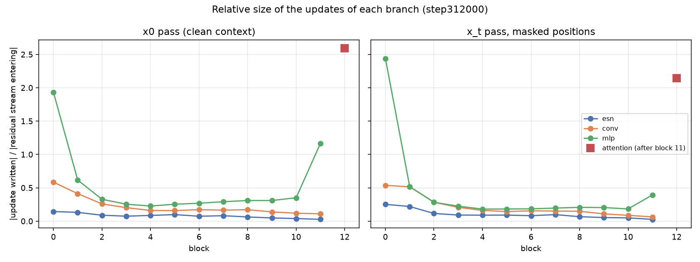
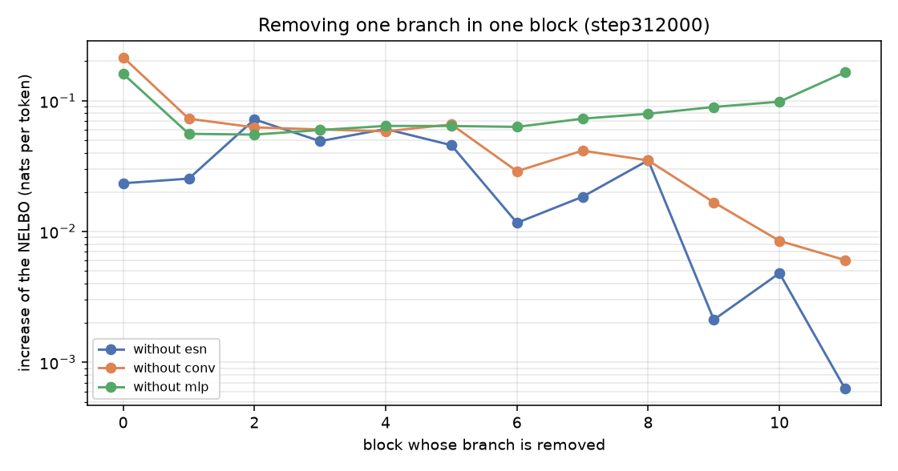
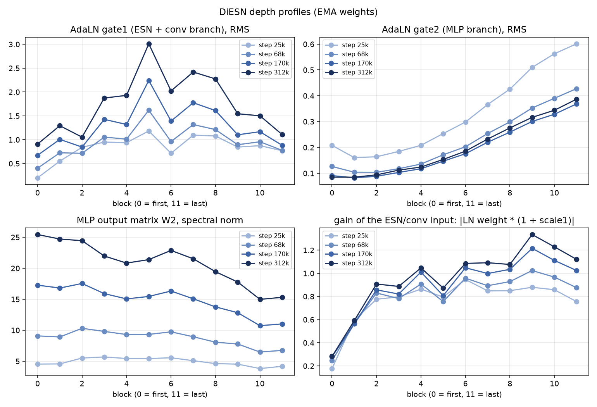

# Analisi dell'addestramento: run `diesn_smdm_bs16`

BD3-LM con backbone DiESN e soft masking SMDM, block size 16, su OpenWebText. La run è partita l'11 ottobre 2026 con un budget di 25.000 step, poi è stata ripresa il 12 ottobre con un budget a epoche (50, LR costante). Il 21 ottobre è stata fermata allo **step 312.000 (18,3 epoche)** perché il server veniva dismesso. I dati sono in [`results/diesn_smdm_bs16/`](../results/diesn_smdm_bs16), gli script in [`analysis/`](../analysis).

## 1. Configurazione

| | |
|---|---|
| Modello | DiESN: 12 blocchi (ParalESN bidirezionale fisso con 768 unità per direzione e 12 teste, ρ ∈ [0,4, 0,9], più conv depthwise k=5 e MLP 4×), 1 strato di attention softmax (12 teste, RoPE, QK norm), d = 768, AdaLN, dropout 0,1. 144M parametri addestrati |
| BD3-LM | block size 16, rumore loglinear, parametrizzazione SUBS, campionamento antitetico, ricerca dell'intervallo di mascheramento (`var_min`), EMA 0,9999 |
| Soft masking | SMDM (top-3), `sm_prob` 0,8, `tran_head_lr` 0,01, `init_scale` 0 (ricetta OpenWebText di IBM) |
| Ottimizzazione | AdamW, LR 3e-4 costante dopo 2,5k step di warmup, weight decay 0, gradient clipping 1, batch 512 × 1024 token |
| Dati | OpenWebText (8,9 miliardi di token di training per epoca; gli ultimi 100k documenti sono la validazione), tokenizer GPT-2 |
| Hardware | 4× A100 80GB PCIe, DDP, `torch.compile`; 0,734 h ogni 1000 step, cioè ~12,5 h per epoca |
| Durata | 312.000 step, 164 miliardi di token, **229,5 h** di soli step di training (`TrainTimer`) |

## 2. Curva di validazione

val/nll è la NELBO per token sull'intervallo completo [1e-3, 1], con i pesi EMA, su 2048 sequenze di validazione, calcolata ogni 5000 step. È la metrica di BD3-LM: PPL = e^nll. La train loss non è confrontabile, perché viene misurata sull'intervallo di mascheramento ristretto scelto dalla ricerca.

| Epoca (indice) | val/nll medio | PPL | Δ rispetto all'epoca precedente |
|---|---|---|---|
| 0 | 3,946 | 51,7 | |
| 1 | 3,705 | 40,6 | −0,242 |
| 2 | 3,631 | 37,7 | −0,074 |
| 3 | 3,581 | 35,9 | −0,049 |
| 4 | 3,557 | 35,1 | −0,024 |
| 5 | 3,540 | 34,5 | −0,018 |
| 7 | 3,516 | 33,7 | |
| 9 | 3,487 | 32,7 | |
| 11 | 3,473 | 32,2 | |
| 13 | 3,458 | 31,8 | |
| 15 | 3,447 | 31,4 | |
| 17 | 3,436 | 31,0 | |

La tabella completa è in `epochs.csv`. La miglior validazione singola è **3,426 (PPL 30,8)** allo step 300k.

- **Rumore di misura.** Con gli stessi pesi, una validazione oscilla di σ ≈ 0,007: è stato misurato ripetendola 6 volte allo step 25k. Le oscillazioni tra validazioni vicine, per esempio 3,426 → 3,456 → 3,440, sono quindi rumore. Conviene guardare la media per epoca, che ha un rumore di circa ±0,004.
- **Andamento.** Nelle prime 3 epoche la discesa è rapida. Poi rallenta: −0,02 per epoca intorno all'epoca 5, circa −0,006 per epoca nelle ultime cinque.
- **Fit a legge di potenza** su tutte le validazioni dallo step 30k, `L(s) = L∞ + A·s^-α`. L'asintoto stimato è L∞ = 3,20 ± 0,07 (α = 0,30), con 3,42 previsto a 25 epoche, 3,38 a 50 e 3,37 a 60. È un'estrapolazione indicativa, ma a LR costante il 3,10 del paper non sembra raggiungibile in un budget paragonabile al suo.

## 3. Confronto con BD3-LM

| | val/nll | PPL | Budget |
|---|---|---|---|
| BD3-LM paper, DiT 110M, L'=16 | 3,10 | 22,27 | 60 epoche: 850k step di pre-training MDLM più 150k a L'=16 |
| BD3-LM paper, DiT, L'=4 | 3,03 | 20,73 | 60 epoche |
| **DiESN + SMDM, L'=16 (questa run)** | **3,44** (media epoca 17) | **31,0** | 18,3 epoche, solo L'=16 |

A parità di dati e di ricetta, la distanza dal paper ha tre cause che qui non si possono separare:

1. **Architettura.** Nel DiT il mescolamento lungo la sequenza è fatto da 12 strati di attention addestrati. In DiESN è fatto da reservoir lineari fissi (con mixer e merge fissi), da una convoluzione k=5 e da un solo strato di attention addestrato.
2. **Budget.** Il 30% delle epoche del paper.
3. **Pre-training.** Il paper parte da 850k step di pre-training MDLM.

Separare il contributo dell'architettura da quello del soft masking richiede le due baseline allo stesso budget (`dit_bs16`, `diesn_bs16`), che non sono state addestrate. Solo come contesto: le run DiESN precedenti, basate sul codice SMDM di IBM con un'impostazione diversa, non erano mai scese sotto 3,7.

**Si poteva battere 3,10? Con questa ricetta, molto difficilmente.**

- **Il divario è grande.** 3,44 contro 3,10 sembrano numeri vicini, ma la NELBO è in scala logaritmica: 0,34 nats per token sono una perplexity più alta del 40% (31,0 contro 22,3). Il divario residuo è più grande di tutto il progresso fatto dall'epoca 1 all'epoca 17 (3,70 → 3,44, cioè 0,26).
- **Il ritmo non basta.** Nelle ultime cinque epoche il guadagno è stato di circa 0,006 per epoca. Anche estrapolando in modo lineare, che è ottimistico perché la curva rallenta, servirebbero più di 50 epoche oltre le 18 fatte. Il fit a legge di potenza dà 3,37-3,38 a 50-60 epoche, e perfino il suo asintoto (3,20 ± 0,07) resta sopra 3,10.
- **C'è un limite strutturale** (sezione 11). Il contesto lungo passa da un solo strato di attention, perché i reservoir hanno una memoria di pochi token. Il DiT del paper ha 12 strati di attention.
- **Leve possibili, nessuna sufficiente da sola:**
  - un decadimento finale del LR, che di solito vale pochi centesimi;
  - reservoir con memoria più lunga (ρ vicino a 1);
  - più strati di attention, che però avvicinerebbero DiESN a un Transformer.

## 4. Intervallo di mascheramento appreso

BD3-LM sceglie a ogni validazione l'intervallo U[β, ω] delle frazioni di mascheramento che minimizza la varianza della NELBO. Qui la scelta è andata così:

| Step | Intervallo scelto |
|---|---|
| 5k | U[0,50, 1] |
| 10k-125k | U[0,45, 0,95] |
| 130k | U[0,40, 0,90] |
| 140k | U[0,35, 0,85] |
| dal 145k in poi | **U[0,30, 0,80]** |

U[0,30, 0,80] è l'intervallo che il paper indica come migliore per L'=16 (Tabella 8). La ricerca ha quindi ritrovato il risultato del paper anche con DiESN.

## 5. Soft masking

La testa di trasparenza calcola `λ = scale · σ(steepness · (-H - centre))`, dove H è l'entropia della predizione preliminare.

| | scale | centre | steepness |
|---|---|---|---|
| Inizializzazione | 0 (soft masking spento) | −0,75 | 6,66 |
| Step 25k | 0,96 | −5,84 | 0,28 |
| Step 312k | **1,00** (saturo dallo step ~117k) | −3,39 | 0,29 |

Valori finali di λ: 0,73 con una predizione sicura (H = 0), 0,53 a 3 nats, 0,32 a 6 nats, 0,21 a 8 nats.

La testa ha "aperto" il soft masking fino in fondo. Allo step 25k, con gli stessi pesi, sostituire le soft mask con maschere binarie peggiorava la NELBO di 0,09 nats (PPL da 40,3 a 44,0): il modello usa davvero l'informazione delle soft mask. È un controllo diagnostico, non un confronto con DiESN senza soft masking.

## 6. Norme degli embedding e token `[MASK]`

Norma dell'embedding d'ingresso di `[MASK]` con i pesi EMA, da `mask_norm_epochs.csv` (rango: 1 = la norma più alta, su 50258 righe):

| Checkpoint | Norma `[MASK]` | Rango | Norma mediana | Coseno massimo con un token |
|---|---|---|---|---|
| step 25k | 1,31 | 18.460 | 1,29 | 0,22 |
| fine epoca 1 | 1,47 | 33.986 | 1,50 | 0,23 |
| fine epoca 5 | 2,24 | 49.737 | 2,61 | 0,25 |
| fine epoca 9 | 2,74 | 49.979 | 3,48 | 0,25 |
| fine epoca 13 | 3,06 | 50.047 | 4,19 | 0,25 |
| fine epoca 17 | 3,33 | 50.068 | 4,78 | 0,27 |

- **Crescita generale.** Con AdamW senza weight decay tutte le righe crescono più o meno come la radice del numero di step: la mediana passa da 1,29 a 4,83.
- **[MASK] cresce meno.** Finisce tra le norme **più piccole** del vocabolario: rango 50.068 su 50.258.
  - Nel BD3-LM ufficiale (`kuleshov-group/bd3lm-owt-block_size16`, senza soft masking) è invece la **4ª più alta**: 11,5 contro una mediana di 8,1. In MDLM è l'11ª.
  - L'ipotesi più plausibile è il soft masking. L'input di una posizione mascherata è dominato dalla miscela dei token predetti (la `scale` della testa è satura a 1, λ ≥ 0,5 per predizioni con meno di ~3,4 nats di entropia), e `e([MASK])` resta un piccolo marcatore che segnala la posizione mascherata.
  - Verificarla richiede la run DiESN senza soft masking.
- **Direzione.** `[MASK]` resta una direzione propria: il coseno con qualunque token non supera 0,27.

## 7. Salute del training

Controlli su `step312000.ckpt` (`analysis/ckpt_analysis.py` e `analysis/direction_analysis.py`):

- **Pesi.** Nessun NaN/Inf, né nei pesi grezzi né in quelli EMA. Reservoir, mixer e merge sono identici bit per bit all'inizializzazione ricostruita con lo stesso seed: le parti congelate non sono state toccate.
- **Gradiente.** Norma RMS ≈ 0,19 nelle ultime ~1000 iterazioni (stimata dai momenti di Adam), sotto la soglia di clipping 1,0.
- **Riga di uscita di `[MASK]`.** È esattamente 0, come deve: con SUBS il suo logit è −∞.
- **Bias d'uscita.** I più alti sono `,` ` the` ` in` ` and`: il modello ha appreso le frequenze dei token.
- **Gate AdaLN.** Tra lo step 25k e il 312k il gate del ramo ESN + conv è cresciuto (|gate| da 0,1-0,8 a 0,6-2,0, massimo nei blocchi centrali), mentre quello dell'attention è sceso da 1,25 a 0,48. **Questo non vuol dire che il modello abbia spostato lavoro dall'attention ai reservoir.** Le misure dirette della sezione 11 mostrano il contrario: l'attention è diventata più importante, e il gate dell'ESN è cresciuto solo per compensare la crescita del flusso residuo.
- **Direzione dei pesi.**
  - Il movimento degli ultimi ~10k step è ancora allineato alla traiettoria complessiva (coseno 0,23 su 144M di pesi; per direzioni casuali sarebbe ~0,0001), a circa metà della velocità media.
  - Gli aggiornamenti per step sono però dominati dal rumore: |m|/√v = 0,14-0,17, il livello del rumore puro.
  - È il regime tipico di un LR costante. Il modello migliora ancora, ma lentamente, ed è plausibile che un decadimento finale del LR (deviazione dalla ricetta di BD3-LM) dia un calo rapido.

## 8. Campioni

Quattro sequenze da 1024 token dallo step 312k (pesi EMA, sampler first-hitting semi-autoregressivo, nucleus 0,9) sono in [`samples_step312000.txt`](../results/diesn_smdm_bs16/samples_step312000.txt). Sono inglese scorrevole che resta sullo stesso argomento: baseball, una serie TV, pinguini, una squadra di esport. Il senso globale resta vago, come ci si aspetta a PPL ~31. Un estratto:

> The big question? Scientists know how many penguins will survive. We have an estimated some 130 million penguins, including at sea. As added advice, scientists reported in the journal Nature that it would help penguins and other females the ability to shear with energy and movement. […]

## 9. Note tecniche

- **Storia su wandb incompleta.** Nella run wandb (`gbenedetti22-unipi/BD3-LMs-DiESN`, run `diesn_smdm_bs16_1`) mancano le righe degli step 25k-166k della sessione ripresa. La storia completa è stata ricostruita dai file locali `.wandb` (`analysis/read_wandb_local.py`) ed è in `validation.csv` e `train.csv`.
- **Rumore uguale su tutte le GPU.** Tutte le 4 GPU usano lo stesso seed, quindi estraggono gli stessi t, le stesse maschere e la stessa scelta tra soft e binario su dati diversi. È così anche nel BD3-LM originale.
- **Checkpoint durante il training.** Gli ultimi 3 checkpoint a step più uno a fine di ogni epoca (`lightning/train.py: checkpoint_callbacks`). Sono stati salvati nella release i pesi dello step 312k e il checkpoint completo di fine epoca 17.

## 10. Cosa resta da fare

1. **Riga ufficiale della tesi** (PPL sull'intera validazione | MAUVE | tempo di addestramento | tempo di inferenza): `lightning/evaluate.py` sui pesi della release. Il tempo di inferenza dipende dall'hardware, e il training è stato fatto su 4× A100.
2. **Baseline allo stesso budget:** `dit_bs16` (BD3-LM originale) e `diesn_bs16` (senza soft masking), con i comandi in `lightning/README.md`. Servono a separare l'effetto dell'architettura da quello del soft masking.
3. **Decadimento finale del LR**, da applicare a tutte le run: è una deviazione dalla ricetta di BD3-LM.
4. **Block size 4**, per il confronto con il miglior risultato del paper, dopo aver misurato il costo di DiESN con blocchi così piccoli.
5. **KV cache per DiESN**, rimandata di proposito.

## 11. Il ruolo di ParalESN (e dell'attention) dentro DiESN

Per capire che cosa fa ogni componente non bastano i pesi. Servono due misure sui dati, fatte sullo step 312k (e per confronto sul 25k), con i pesi EMA e su sequenze di validazione di OpenWebText (ultimo shard del dataset, dentro gli ultimi 100k documenti). Script: `analysis/paralesn_role.py` e `analysis/depth_profiles.py`.

- **Contributi.** Per ogni blocco, quanto è grande l'aggiornamento che ciascun ramo scrive nel flusso residuo, in rapporto alla norma del flusso che entra nel blocco. Si misura sia nella passata x0 (la sequenza pulita, cioè il contesto) sia nella passata x_t (le posizioni mascherate). Dati in `role_step*_contributions.csv`.
- **Ablazioni.** Di quanto sale la NELBO togliendo un ramo, con gli stessi t e le stesse maschere. Dati in `role_step*_ablations.csv`. Ci sono due tipi di ablazione:
  - *togliere il ramo*: la sua uscita diventa zero;
  - *togliere solo il contesto tra blocchi*: il ramo continua a lavorare dentro il blocco, ma non riceve più nulla dai blocchi precedenti. Per l'ESN il reservoir forward riparte da zero a ogni blocco; per la conv le 2 posizioni prima del blocco diventano zero; per l'attention ogni blocco legge solo se stesso.

  Il secondo tipo è più pulito del primo, perché il resto della rete continua a ricevere ingressi del tipo che si aspetta.

### 11.1 La memoria dei reservoir è corta

ParalESN è una ricorrenza lineare a coefficienti complessi, fissa: `h_t = λ ⊙ h_t-1 + u_t`. Ogni unità decade come |λ|^k. I 768 autovalori per direzione di ciascun blocco hanno |λ| ∈ [0,46, 0,91] (mediana 0,82), da `esn_rho_min` 0,4 e `esn_rho_max` 0,9. Quindi:

- l'**emivita** di un'unità è in mediana **3,5 token** e al massimo 7,3;
- dopo un blocco di 16 token resta al più il **22%** dello stato, in mediana il 4-5%.

Il reservoir è quindi una banca fissa di filtri esponenziali e oscillanti con una memoria di pochi token: un **mescolatore locale**, non un modello del contesto lungo. In più non ha una proiezione d'uscita addestrabile: l'uscita passa per `tanh`, un mixer fisso e una matrice di merge fissa. Gli unici controlli addestrabili sono l'ampiezza dell'ingresso (LayerNorm + scale/shift di AdaLN) e il gate1, che l'ESN condivide con la convoluzione.

### 11.2 Quanto scrive ogni ramo

Rapporto |aggiornamento| / |flusso residuo entrante| allo step 312k:

| | ESN (x0) | conv (x0) | MLP (x0) | ESN (x_t) | conv (x_t) | MLP (x_t) | norma del flusso entrante (x0) |
|---|---|---|---|---|---|---|---|
| blocco 0 | 0,14 | 0,59 | 1,93 | 0,25 | 0,54 | 2,44 | 3,9 |
| blocco 1 | 0,13 | 0,41 | 0,62 | 0,22 | 0,52 | 0,52 | 9,2 |
| blocco 2 | 0,09 | 0,26 | 0,33 | 0,12 | 0,28 | 0,28 | 14,3 |
| blocco 5 | 0,10 | 0,16 | 0,25 | 0,09 | 0,14 | 0,18 | 23,4 |
| blocco 8 | 0,06 | 0,17 | 0,31 | 0,07 | 0,15 | 0,21 | 34,9 |
| blocco 11 | 0,03 | 0,11 | 1,17 | 0,03 | 0,06 | 0,39 | 45,4 |

L'**attention**, dopo il blocco 11, ha un rapporto di **2,59** nella passata x0 e di **2,14** nella passata x_t; il flusso che riceve ha norma 80,3 nella passata x0.

- **L'attention domina la rappresentazione finale.** L'unico strato di attention scrive un aggiornamento **2,1-2,6 volte più grande del flusso residuo** che riceve: dopo l'attention la rappresentazione è soprattutto quello che l'attention ha scritto.
- **ESN e conv pesano poco, e sempre meno.** Il ramo ESN scrive il 3-25% del flusso, la convoluzione il 6-59%, e il peso relativo di entrambi scende con la profondità.
- **ESN e conv si compensano.** Gli aggiornamenti dei due rami sono quasi sempre **anti-correlati** (coseno negativo fino a −0,5; positivo solo nel blocco 1): la convoluzione, che si addestra, corregge in parte le feature fisse dell'ESN.

### 11.3 Che cosa succede togliendo i pezzi

Aumento della NELBO (nats per token):

| Ablazione | step 25k | step 312k |
|---|---|---|
| NELBO di riferimento | 3,651 | 3,387 |
| senza ESN (tutti i blocchi) | +0,43 | **+0,49** |
| senza convoluzione (tutti i blocchi) | +3,76 | +3,93 |
| senza attention | +1,90 | **+2,93** |
| senza MLP (tutti i blocchi) | +4,97 | +5,53 |
| ESN senza contesto tra blocchi | +0,25 | +0,24 |
| conv senza contesto tra blocchi (2 posizioni) | +0,38 | +0,41 |
| attention senza contesto tra blocchi | +0,87 | +0,75 |
| contesto portato solo dall'attention | +0,66 | +0,68 |
| contesto portato solo dall'ESN | +1,09 | +1,08 |
| nessun contesto tra blocchi | +1,07 | +1,13 |

Per tutte le ablazioni di contesto il danno cresce con la frazione di mascheramento del blocco: per l'attention, allo step 312k, è +0,63 con t < 1/3 e +0,88 con t > 2/3. È atteso: più il blocco è mascherato, più conta ciò che arriva da fuori.

Togliendo un solo ramo in un solo blocco (step 312k):

| | ESN | conv | MLP |
|---|---|---|---|
| blocco 0 | +0,023 | **+0,214** | +0,160 |
| blocco 2 | **+0,072** | +0,063 | +0,055 |
| blocco 4 | **+0,061** | +0,058 | +0,064 |
| blocco 5 | +0,046 | +0,066 | +0,064 |
| blocco 8 | +0,035 | +0,035 | +0,079 |
| blocco 10 | +0,005 | +0,009 | +0,098 |
| blocco 11 | +0,001 | +0,006 | **+0,165** |

### 11.4 Il ruolo di ParalESN

- **È importante ma non dominante.** Senza tutti i reservoir la NELBO sale di 0,49 nats (perplexity da 30 a 48). È molto meno di quanto costa togliere conv, attention o MLP, ma non è trascurabile: il modello li usa.
- **Lavora nei blocchi bassi e centrali.** Conta soprattutto nei blocchi 2-5 (fino a +0,07 ciascuno), che sono anche quelli dove il suo gate è più alto, ed è quasi inutile negli ultimi tre (+0,001-0,005). Le feature locali dei reservoir servono a costruire la rappresentazione nei primi strati. Poi il lavoro passa alle MLP e all'attention.
- **È un mescolatore locale, complementare alla convoluzione.** Entrambi guardano pochi token, ma la convoluzione, che si addestra, fa la parte più grossa (aggiornamenti da 1,5 a 4 volte più grandi) e corregge l'uscita fissa dell'ESN. Che togliere tutte le convoluzioni sia catastrofico (+3,9) non dipende solo dall'informazione che portano: la rete si è adattata a ricevere la somma "ESN + correzione". Togliendo solo la correzione resta l'uscita grezza dei reservoir, che non si è mai vista da sola.
- **Porta un po' di contesto tra blocchi, ma solo quello vicino.** Togliere il contesto dell'ESN, con conv e attention intatte, costa +0,24: il reservoir porta nelle prime posizioni del blocco gli ultimi token del blocco precedente, utili come contesto immediato. Da solo, però, l'ESN non basta: con il contesto portato solo dall'ESN si perde quasi quanto senza alcun contesto (+1,08 contro +1,13). Con una memoria di pochi token, dopo il confine di blocco resta troppo poco.
- **Il contesto lungo è tutto dell'attention.** Con il contesto portato solo dall'attention si recupera quasi metà della perdita (+0,68 invece di +1,13). Quindi l'unico strato di attention è il collo di bottiglia del contesto lungo, e durante il training la sua importanza è **cresciuta**: senza attention si perdono +1,90 nats allo step 25k e +2,93 allo step 312k, e il suo aggiornamento relativo passa da 1,5 a 2,1-2,6.

### 11.5 Perché il gate dell'ESN è salito e quello dell'attention è sceso

Il gate di AdaLN non misura l'importanza di un ramo, a causa di una **simmetria di scala**. Quello che entra nel flusso residuo è il prodotto `gate × uscita del ramo`, e la stessa ampiezza si può ottenere con un gate grande e un'uscita piccola o viceversa. AdamW senza weight decay fa crescere i pesi durante il training, quindi anche il flusso residuo cresce: all'ingresso del blocco 5 passa da 14,9 a 23,4 tra lo step 25k e il 312k.

- **Ramo ESN + conv.** L'uscita dell'ESN è limitata (`tanh`, mixer e merge fissi) e i pesi della convoluzione sono rimasti quasi alla norma iniziale (15-20). Per tenere lo stesso peso relativo in un flusso residuo che cresce, l'unica manopola è il **gate1**, che infatti è salito. Nel blocco 5 il gate1 passa da 1,2 a 3,0, ma l'aggiornamento relativo dell'ESN resta lo stesso (0,099 → 0,098).
- **Attention e MLP.** Hanno matrici addestrabili che sono cresciute molto: `c_v` e `c_proj` circa 7,5 volte, la norma spettrale di W2 delle MLP di 3,5-5,5 volte. Così il loro gate è potuto scendere senza ridurre l'aggiornamento: per l'attention è anzi aumentato.

In breve, la crescita del gate dell'ESN è una **compensazione**, non uno spostamento di lavoro. In termini di quello che viene scritto, e di quanto costa toglierlo, l'attention ha guadagnato importanza e l'ESN l'ha mantenuta.

### 11.6 AdaLN dai blocchi bassi a quelli alti

Senza condizionamento sul tempo (`time_conditioning=False`, quindi σ = 0) l'AdaLN non si adatta a nulla. È una costante appresa per blocco: per ogni canale uno shift, una scala e un gate, cioè l'equivalente dei parametri affini della LayerNorm più un *LayerScale*. Profilo allo step 312k, RMS sui canali (`depth_profiles.csv`, `depth_profiles.png`):

| Blocco | 0 | 1 | 2 | 3 | 4 | 5 | 6 | 7 | 8 | 9 | 10 | 11 |
|---|---|---|---|---|---|---|---|---|---|---|---|---|
| gate1 (ESN + conv) | 0,91 | 1,29 | 1,05 | 1,87 | 1,93 | **3,01** | 2,02 | 2,42 | 2,27 | 1,54 | 1,50 | 1,11 |
| gate2 (MLP) | 0,09 | 0,09 | 0,09 | 0,11 | 0,12 | 0,15 | 0,19 | 0,23 | 0,28 | 0,32 | 0,34 | **0,39** |
| guadagno in ingresso a ESN/conv | **0,28** | 0,59 | 0,91 | 0,89 | 1,05 | 0,87 | 1,09 | 1,09 | 1,08 | 1,34 | 1,23 | 1,12 |
| guadagno in ingresso all'MLP | 0,24 | 0,62 | 0,74 | 0,72 | 0,68 | 0,63 | 0,57 | 0,55 | 0,55 | 0,55 | 0,55 | 0,53 |

Il guadagno in ingresso è `|peso della LayerNorm × (1 + scale)|`. Quello dell'attention è 2,13 e quello del layer d'uscita 2,30.

- **gate1** sale fino al centro della rete (blocco 5) e poi scende: ha la stessa forma dell'importanza dell'ESN misurata con le ablazioni.
- **gate2** cresce in modo monotono con la profondità, di 4,5 volte dal primo all'ultimo blocco. Durante il training è *sceso* a tutte le profondità (allo step 25k andava da 0,21 a 0,60), mentre i pesi delle MLP crescevano: è la stessa simmetria di scala.
- **Il primo blocco attenua molto l'ingresso dei reservoir** (guadagno 0,28 contro ~1 nei blocchi successivi). Nel primo blocco i reservoir leggono l'embedding attenuato, e la parte grossa del lavoro la fanno la convoluzione e l'MLP.

### 11.7 Le MLP con la profondità

Nei Transformer pre-LN la norma del flusso residuo **cresce** con la profondità: ogni strato somma il proprio aggiornamento e nulla la riporta indietro. Gli strati più profondi scrivono quindi aggiornamenti più grandi in valore assoluto, per contare ancora su un flusso più grande. Qui succede lo stesso:

- **Il flusso residuo cresce.** Nella passata x0 cresce di 11,5 volte nei 12 blocchi (da 3,9 a 45,4), poi l'ultima MLP lo porta a 80 e l'attention a 150.
- **Gli aggiornamenti assoluti delle MLP crescono** dal blocco 2 in poi (4,7 → 5,9 → 10,8 → 15,0 → 52,9 per i blocchi 2, 5, 8, 10, 11), mentre quelli relativi seguono una U: 1,9 nel primo blocco, 0,2-0,35 al centro, 1,2 nell'ultimo.
- **Il primo MLP riscrive quasi l'embedding**: aggiornamento doppio del flusso residuo, e togliere quel solo MLP costa +0,16. È un comportamento noto anche nei Transformer: in GPT-2 il primo MLP funziona di fatto come un'estensione dell'embedding.
- **L'importanza delle MLP cresce con la profondità** dal blocco 1 in poi (+0,056 → +0,165), mentre ESN e conv perdono importanza: gli strati alti fanno soprattutto calcolo per token.
- **Le norme dei pesi delle MLP**, invece, sono quasi uguali in tutti i blocchi: Frobenius ~222-233 per W1 e ~197-210 per W2, perché Adam aggiorna ogni coordinata con un passo simile. La norma spettrale di W2 addirittura **cala** con la profondità (da 25 a 15). La crescita degli aggiornamenti con la profondità non viene dai pesi ma dal **gate2** (×4,5) e dal flusso residuo, che cresce. Per confrontare gli strati conta il prodotto, non i pesi da soli.

### 11.8 In sintesi

In DiESN, dopo 18 epoche, i ruoli sono questi:

- **Reservoir e convoluzione** fanno il mescolamento locale nei blocchi bassi e centrali. La convoluzione addestrata ha il ruolo principale e corregge le feature fisse dei reservoir, che restano utili (+0,49 nats se si tolgono).
- **Le MLP** fanno il calcolo per token, sempre più importante salendo.
- **L'unico strato di attention** porta il contesto lungo e scrive la parte più grande della rappresentazione finale.

Il limite principale del design è che i reservoir, con |λ| ≤ 0,91, ricordano solo pochi token. Possibili esperimenti, da decidere e da confrontare con le baseline allo stesso budget:

- **ρ più vicino a 1** (per esempio `esn_rho_max` 0,99, emivita ~70 token), per vedere se i reservoir iniziano a portare contesto tra blocchi;
- **una proiezione d'uscita addestrabile per l'ESN**, che però cambia `diesn.py`;
- **un secondo strato di attention a metà rete.**
